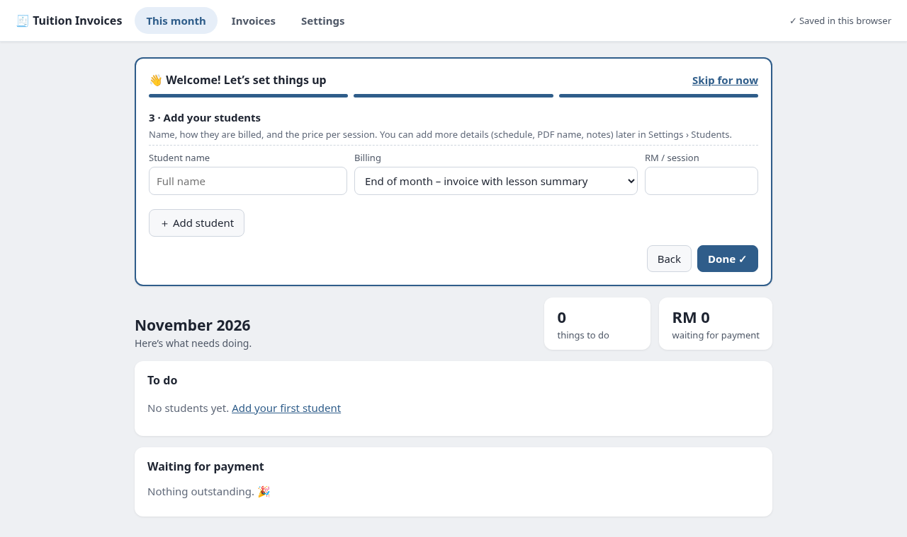

# Tuition Invoice Maker

A small desktop app for private tutors. It makes monthly invoices and lesson summaries as PDFs, and keeps track of who has paid.

## Features
- **This month** screen: one line per student showing what's due (create the invoice, write the summary, continue a draft) and its status (*Not started*, *Late*, *Draft*, *Sent · not paid*, *Paid*).
- **Waiting for payment** list with the total owed and a one-click **Mark paid**.
- Three billing styles per student:
  - end-of-month invoice with a lesson summary
  - start-of-month invoice for booked slots (filled in from a weekly schedule; slots can be rescheduled)
  - start-of-month invoice, plus a separate lesson summary at the end of the month
- A live A4 preview that matches the PDF exactly. Automatic week numbers, totals, invoice numbers and "last payment received" lines.
- Checks before saving (RM 0 price, empty account number, lessons without a date or topic), Undo for deletions, and a ready-to-paste WhatsApp message.
- A short guided tour the first time the app opens, and another the first time an invoice is opened. You can replay them in Settings › Help.
- Emoji picker (😊 button) in the closing message, note, greeting and WhatsApp message fields. Search it, or browse 6 categories and your recently used emoji. Works offline.
- Everything saves automatically, with a daily backup of the last 30 days. Colour themes include Classic and Catppuccin Latte / Frappé / Macchiato / Mocha.

The app starts empty: a short setup asks for your details, bank account and students. No student data is included.



## Downloads
Get the Windows installer from the [Releases](../../releases) page:
- `Tuition-Invoice-Maker-Tauri-Setup-x.y.z.exe`: small (about 1 MB), uses Windows' built-in WebView2. Recommended.
- `Tuition-Invoice-Maker-Tauri-Smooth-Setup-x.y.z.exe`: the same app with animations.
- `Tuition-Invoice-Maker-Setup-x.y.z.exe`: the Electron build (about 120 MB).

The installers aren't code-signed. The first time you run one, Windows SmartScreen may show "Windows protected your PC". Click **More info → Run anyway**.

Your data is stored in `Documents\Tuition Invoices\`:
- `invoice-data.json`: your data
- `backups\`: the daily backups
- `YYYY-MM\*.pdf`: the PDFs, one folder per month

There's also a no-install version: open `invoice-maker.html` in Chrome or Edge. It stores data in the browser, so use **Settings › Save a backup** now and then.

## Project layout
| Folder | What |
|---|---|
| `app/` | Electron app. `app/renderer/index.html` is the whole UI, shared by every build. See [app/README.md](app/README.md) |
| `tauri/` | Tauri 2 (Rust) app using the same UI. See [tauri/README.md](tauri/README.md) |
| `invoice-maker.html`, `invoice-maker-smooth.html` | Standalone single-file builds (`node app/scripts/build-html.mjs`) |

## Build and test
```bash
cd app   && npm install && npm start            # Electron, run locally
cd app   && npm run selftest                    # drives the UI, exports PDFs, checks totals
cd tauri && npm install && npm start            # Tauri, run locally (needs Rust)
cd tauri && npm run build:win                   # Windows installer, cross-built on Linux
```

## Licence
MIT. See [LICENSE](LICENSE).
